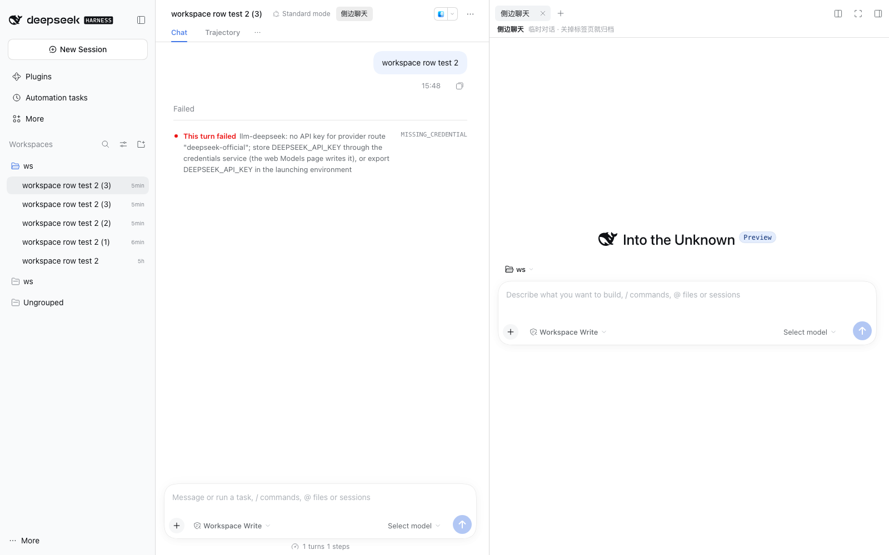
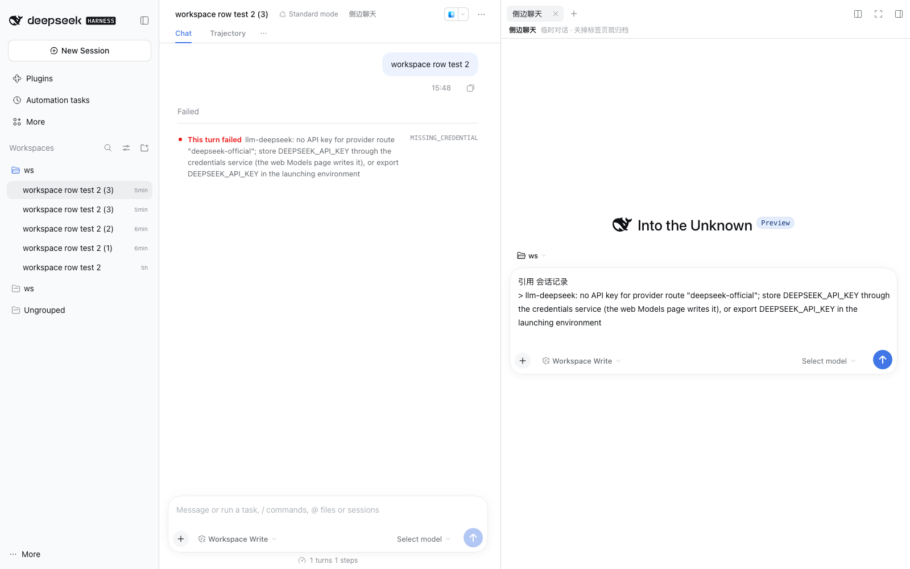

# dsh-sidechat

Codex 风格的**侧边聊天**：右侧栏里一个**临时的空对话面板**，和主对话并排。选中的文字可以「带进侧边聊天」当作片段。



从主对话里选中文字 →「侧边提问」→ 片段自动写进侧边输入框：



## 上下文（v0.3）

侧边聊天**默认携带主对话历史**，但它不会显示在聊天记录里：

- 侧边会话 id 里编码父会话 id（`session-sidechat-<base64url(parent)>-<rand>`）；
- host 半端在 `agent/created` 时认出这种会话，用
  `agent.ctx.inject(['systemPrompt'])` → `scope.systemPrompt.section({ text: () => … })`
  给**这一个 agent** 注册一段系统提示词（每会话作用域）；
- `text` 是函数：每次组装系统提示词时重新读取主对话最近的「用户/助手」文本
  （跳过工具调用与结果，最近约 24k 字符），所以侧边里继续追问时上下文也是最新的；
- 系统提示词不进聊天记录：侧边面板里只有你的提问、模型的回答，以及（从选区进来时）那段引用片段。

因此模型看到的是：**主对话历史（隐藏 system 段）+ 引用片段 + 你自己的提问 + 侧边会话自己的历史**。

## 它做了什么

1. 会话 header 里多一个 **「侧边聊天」** 按钮（就在 `Standard mode` 右边）；
2. 点一下：**建一个空白会话**（同工作区、随机 id、不复用旧 blank），不是 fork —— 所以面板一开始是干净的空对话；
3. 用资源地址 `dsh-resource://sidechat/session/<id>` 在右侧栏打开一个 tab，tab 头写着「临时对话 · 关掉标签页就归档」；
4. 面板本体复用宿主的 `conversation.content` Component Factory（`variant: embedded`，固定 `view: chat`）——跟主对话是同一套输入框、历史、工具行、`@` 引用、模型选择器；
5. 另有入口：主对话里选中文字 → 浮条上的 **「侧边提问」** → 开会话并把「引用片段」写进侧边输入框草稿（不自动发送），对应 Codex 的 Ask in side chat；
6. 上下文：主对话历史自动注入成**隐藏系统提示词段**（见上一节），面板里看不到。

### 临时性

| 时机 | 行为 |
|---|---|
| 关掉侧边 tab | 立即归档该会话（`workspace/archiveSession`），从会话列表消失 |
| 关掉 App / 刷新应用 | 下次启动时把上一轮仍开着的侧边会话统一归档（localStorage 记账，只在页面第一次 apply 时清扫，HMR 不会误伤） |
| 失败 | 重试并记录在 `dsh-sidechat:sweep`，不抛错 |

会话是真 Session（复用宿主 create/archive），不是内存里的假对话——所以**开着的时候**它仍会以普通会话行的形式出现在左侧列表里，关掉/重启后才消失。

## 关键行为

| 行为 | 说明 |
|---|---|
| 主对话不受影响 | 只用 `sessions.create` + `sidebarRight.openResource`，**不调用** `openSession`，主栏选择不变 |
| 草稿互相隔离 | 侧边面板是独立 Session；在侧边输入只有侧边草稿变化（实测主输入框保持空） |
| 多个侧边聊天 | 每点一次开一个新空白会话 → 新资源地址 → 新 tab，可并存 |
| 关闭 tab | 资源提供方随 tab 中止 `release()`；同时 RPC 归档该会话 |
| 失败 | 只弹一句 toast，不把异常冒到宿主 UI |
| 窗口 | 入口按钮在 header actions（宿主声明的 no-drag 区），不覆盖窗口、不影响拖拽/双击标题栏 |

## 安装

```sh
# npm（推荐）
dsh plugin --profile desktop add dsh-sidechat

# 或直接钉 Git 提交
dsh plugin --profile desktop add "git+https://github.com/xywen97/dsh-sidechat.git"
```

也可以走桌面版 `设置 → 插件 → 安装`，spec 填 `dsh-sidechat`。
装完**重启一次 DSH**（host 半端有上下文注入逻辑，重启才加载；客户端部分可热加载）。

### 配套插件

「选中文字 → 侧边提问」入口由同作者的选区插件提供：

```sh
dsh plugin --profile desktop add dsh-selection-chat
```

只装本插件时，侧边聊天可以从会话 header 的「侧边聊天」按钮进入。

## 依赖的宿主契约（0.2.x 实测）

- 客户端服务：`sessions`（`create` / `retain` / `list`）、`workspaces`、`slots`、`sidebarRight`、`resources`
- 归档：同源 `POST /api/workspace/archiveSession`（client-request envelope）
- tab 类型：`ctx.sidebarRightTabs.register({ kind, patterns, canOpen, title, priority })`
- tab 正文：槽位 `sidebar.right.pane.tab`（`key`），声明子槽位 `sidechat.conversation`（`scope: 'session'`）
- 会话引用：`sessions.retain(sessionId, { source, signal })`，`release()` 卸载
- 关闭 hook：`ctx.sidebarRight.registerCloseHandler('sidechat', (sessionId, tab) => …)`
- 复用渲染：`renderFactorySlot('conversation.content', { variant: 'embedded', phase, hero }, { slots: { views } })`
- 入口席位：`conversation.session.header.actions`

宿主换掉这些时插件会静默降级（按钮在、点了 toast 报错，不影响主 UI）。

## 已验证

在独立 DSH_HOME + 独立端口用无头 Chrome 实测：

- 点按钮 → 右栏出现「侧边聊天」tab：**空白英雄页** + 自己的输入框（无主对话历史）；
- 主对话里选中文字 → 浮条出现「加入对话 / 侧边提问 / 评论」→ 点「侧边提问」→ 新侧边会话里草稿出现 `引用 会话记录 > …`，主输入框保持空；
- 连点两次得到两个独立侧边聊天 tab；关掉一个，另一个照常工作；
- 在侧边发一条消息 → 会话出现在左侧列表；关掉 tab → 该行消失（已归档）；`dsh-sidechat:sweep` 记录启动清扫 `ok: true`；
- 主栏 `dsh.sessions.current` 全程未变。

## 已知限制

- 侧边聊天是**真实 Session**：开着时仍会出现在左侧会话列表（关掉 tab / 重启后归档消失）；
- 归档不是删除，磁盘上仍有记录（宿主没有面向客户端的删除会话 RPC）；
- 面板里没有单独的「关闭/归档」按钮，用 tab 的关闭控件即可；
- **host 半端有改动时需要重启一次 DSH**（客户端部分仍可热加载）；
- 上下文取的是「打开侧边聊天那一刻」的父会话 agent；如果父会话已关闭/未在线，就退化为不带主对话上下文；
- 没有键盘快捷键（宿主 header 里的按钮就是入口）。
